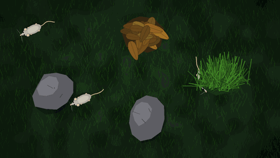
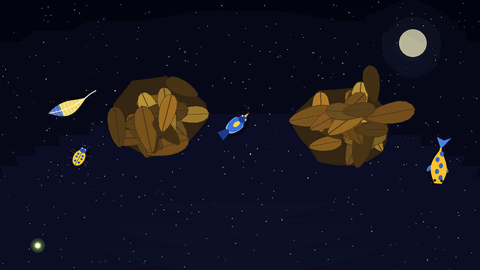
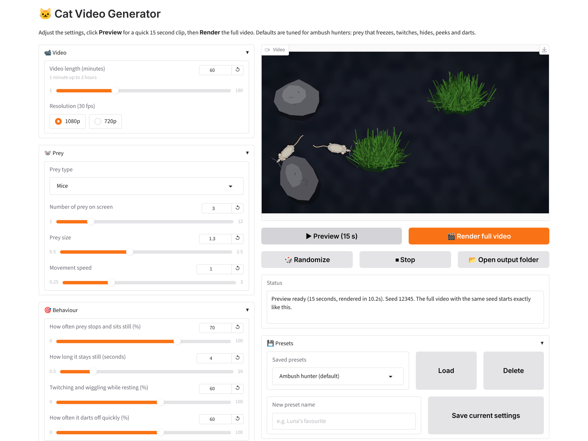

# 🐱 Cat Video Generator

Make videos for your cat to watch: little mice, bugs, birds, fish, feathers and laser dots that
sneak around, freeze, twitch, hide behind grass, leaves and rocks, peek out and then dart away.
Everything (prey, backgrounds and sounds) is drawn and generated with code, so there are no
image or audio files to download.

You run one command, a control panel opens in your browser, and you just move sliders and click
buttons. No coding needed.

| Mice on grass | Mixed prey under the night sky |
| --- | --- |
|  |  |



## Made for ambush hunters

Most cats are ambush hunters. They are most interested in prey that **sits still and then moves or
rustles a little**, not prey that zooms around nonstop. The default settings reflect that:

* prey **stops and sits still** for a few seconds,
* **twitches** (a flick of the tail, a wiggle, a tiny shuffle forward) while resting,
* sneaks behind grass, leaves or rocks, **peeks out** with a rustle,
* then **darts away** quickly and freezes again.

Prey is drawn in **blues and yellows**, the colours cats see best, on **darker backgrounds** for good
contrast.

---

## Setup on Windows (step by step)

You only need to do steps 1 to 4 once.

### 1. Install Python

1. Go to <https://www.python.org/downloads/> and click the big **Download Python 3.x** button
   (3.10 or newer).
2. Run the installer. **Important:** on the first screen tick **"Add python.exe to PATH"**, then click
   **Install Now**.
3. To check it worked, open **Command Prompt** (press the Windows key, type `cmd`, press Enter) and type:

```bash
python --version
```

You should see something like `Python 3.12.4`.

### 2. Get this project

* **Easy way:** on the GitHub page click the green **Code** button, then **Download ZIP**. Unzip it
  somewhere easy to find, for example `C:\Users\<you>\Documents\cat-video-generator`.
* **Or with Git:** `git clone` the repository.

### 3. Create a virtual environment

A virtual environment keeps this project's packages separate from the rest of your computer.
In Command Prompt, go into the project folder (change the path to wherever you unzipped it):

```bash
cd %USERPROFILE%\Documents\cat-video-generator
```

```bash
python -m venv venv
```

```bash
venv\Scripts\activate
```

After activating, you will see `(venv)` at the start of the line.

> If you use **PowerShell** instead of Command Prompt and get an error about scripts being disabled,
> run `Set-ExecutionPolicy -Scope CurrentUser RemoteSigned` once, answer `Y`, and try again.

### 4. Install the requirements

```bash
pip install -r requirements.txt
```

This installs Gradio (the control panel), NumPy and Pillow (drawing) and imageio-ffmpeg, which
includes its own copy of **ffmpeg**, so you do not need to install ffmpeg separately.

### 5. Run the app

Every time you want to use it, open Command Prompt and run:

```bash
cd %USERPROFILE%\Documents\cat-video-generator
```

```bash
venv\Scripts\activate
```

```bash
python app.py
```

The control panel opens in your web browser automatically. If it does not, open
<http://127.0.0.1:7860> yourself. To quit, close the browser tab and press **Ctrl + C** in the
Command Prompt window.

---

## Using the control panel

| Button | What it does |
| --- | --- |
| **▶ Preview (15 s)** | Renders a quick 15 second clip and plays it right in the app. |
| **🎬 Render full video** | Renders the full length video, with a progress bar and time remaining. |
| **🎲 Randomize** | Picks random prey, background, behaviour and sounds so you can try variety. Your video length and resolution are kept. |
| **⏹ Stop** | Stops a render that is in progress. |
| **📂 Open output folder** | Opens the folder with your finished videos. |
| **💾 Presets** | Type a name and click **Save current settings** to keep a favourite. Pick it from the list and click **Load** later. |

### Settings

* **Video:** length from 1 minute to 3 hours, 1080p (default) or 720p, always 30 fps.
* **Prey:** bugs, mice, birds, fish, feathers, grasshopper, laser dot, or mixed; how many on screen, size and speed.
  The grasshopper is drawn from the side (in profile) and leaps around in fast arcs.
* **Behaviour:** how often prey stops and sits still, how long it stays still, how much it twitches
  while resting, and how often it darts off.
* **Hiding:** turn hiding on or off, pick grass, leaves, rocks or mixed, the number of hiding spots
  and how often prey goes to hide.
* **Background:** dark solid, black (projector), grass, wooden floor, water, night sky, or your own colour with the
  colour picker.
* **Sound:** on or off, volume, and which sounds: rustling, scratching, bird chirps, mouse squeaks,
  grasshopper clicks.
* **Seed:** with **Use fixed seed** ticked, the same settings always give exactly the same video.
  Untick it for a new surprise each time. The seed used is always shown in the status box and in
  the file name, so you can recreate a video you liked. A preview is exactly the first 15 seconds of
  the full video with the same seed and settings.

### Projecting onto the floor

Load the **Grasshopper (projector)** preset. It uses the **Black (projector)** background: black means
the projector sends no light there, so only the prey appears on the floor and the rest stays dark.
A dark room makes it pop the most.

### Where are my videos?

Finished videos are saved in the **`output`** folder inside the project folder, with a descriptive
name like:

```
mice_dark-solid_1h_2026-11-03_1542_seed12345.mp4
```

(prey type, background, length, date and time, seed). Previews go into `output\previews` and only the
last few are kept. Your presets are saved in `presets.json` in the project folder.

### How fast is it?

Frames are drawn with NumPy and Pillow, only redrawing the small areas around the prey, and are
streamed straight into ffmpeg, so memory use stays low even for 3 hour videos. On a typical
4 core PC a 1080p video renders about 1.5 to 4 times faster than real time (a 1 hour video takes
roughly 15 to 40 minutes). 720p is faster still.

---

## Tips for uploading to YouTube

* **Titles:** say what is in it and how long it is, for example
  *"Videos for Cats: Mice Hiding in the Grass 🐭 1 Hour of Cat TV"*. Words people search for:
  "cat TV", "videos for cats to watch", "for cats", plus the prey and the length.
* **Description:** mention the prey, the sounds and the length, and that it was designed for cats
  (still, twitching prey and cat friendly blue and yellow colours).
* **Audience setting ("made for kids"):** YouTube requires you to answer this honestly. A video made
  **for cats** is usually **not made for kids**, so choose **"No, it's not made for kids"** unless you
  are deliberately aiming it at children (for example with child focused titles, characters or
  themes). Choosing "made for kids" turns off comments, notifications and some features, so only use it
  when it truly applies. If you are unsure, read YouTube's own guidance in YouTube Studio.
* **Keep it a standard video:** upload as a normal (landscape, 16:9) video rather than a Short.
  Long videos (1 to 3 hours) work well for cat TV because people leave them running.
* **Thumbnails:** pause a preview on a nice moment (for example a mouse peeking out of the grass)
  and take a screenshot with **Win + Shift + S**. Use a big, close, colourful prey, high contrast, and a
  few large words like "CAT TV 1 HOUR". YouTube thumbnails should be 1280 × 720 pixels.
* **Sound:** some cats react strongly to sound. Try a preview with your cat first and adjust the
  volume or sound types.
* **Safety:** watch your cat the first few times. Some cats paw at or jump at screens, so make sure
  the TV or tablet is stable.

---

## For tinkerers: project layout

Each part is its own module, so adding something new means writing one function and adding it to a
dictionary.

```
app.py                  The Gradio control panel (run this)
catvid/settings.py      All settings, defaults, Randomize and file names
catvid/presets.py       Saving and loading presets (presets.json)
catvid/prey.py          Prey drawings (add a draw function + PreyKind to PREY_KINDS)
catvid/behavior.py      How prey moves: wander, freeze, twitch, hide, peek, dart
catvid/covers.py        Hiding objects: grass, leaves, rocks (add to COVERS)
catvid/backgrounds.py   Backgrounds (add a make function to BACKGROUNDS)
catvid/sounds.py        Generated sounds (add to SOUNDS) and the streaming soundtrack
catvid/renderer.py      Draws frames and streams them to ffmpeg
tests/                  Basic tests: run with  python -m pytest
scripts/make_readme_previews.py   Rebuilds the GIFs in docs/
```

Rendered videos are never committed: the `output/` folder is in `.gitignore`.
